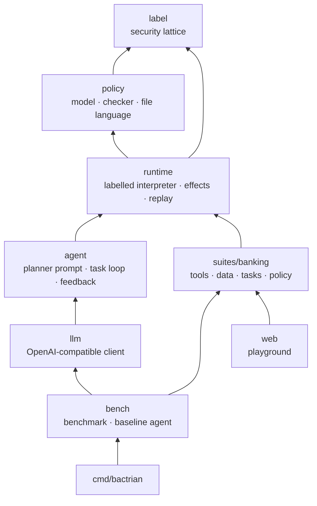

# Architecture

Bactrian is a small set of MoonBit packages with one-way dependencies:



Only `llm`, `bench` and `cmd/bactrian` perform I/O. Everything below them is
pure and runs unchanged on every MoonBit backend; the playground is the same
code compiled to JavaScript.

## 1. Labels (`label/`)

Every value carries a `Label`:

| component | meaning | combining two values |
|---|---|---|
| `sources : Set[Source]` | where the data came from: `User`, `Plan` (a literal the planner wrote), `Tool(name)`, `Party(name)` (an external author) | union |
| `readers : Public \| Only(Set[principal])` | who may read it | intersection |
| `origins : Set[Int]` | which tool / assistant calls it came from (for explanations only) | union |

This is a product lattice; `join` is its least upper bound. Trust is decided by
the policy: a label is trusted when every source is (`User` and `Plan` always
are; a tool or party only if the policy says so). QuickCheck properties check
the lattice laws.

## 2. The interpreter (`runtime/`)

The plan language is a Python subset (parsed by
[pure-py](https://github.com/marianoguerra/pure-py-mb), which produces a
CPython-shaped AST): assignments, `if`/`elif`/`else`, `for` with
`break`/`continue`, comprehensions, f-strings, pure lambdas, records declared as
`class X(BaseModel)`, and the usual builtins and methods of `str`, `list` and
`dict`. There is no `def`, `while`, `try`, `import` or I/O: every program
terminates, and the only way to reach the outside world is a tool call.

### Values

```
Item  = { value : Value, label : Label }
Value = VNone | VBool | VInt | VFloat | VStr
      | VList(ListObj)   ListObj  = { items : Array[Item], mut shape : Label }
      | VDict(DictObj)   DictObj  = { entries : Map[key, (Item, Item)], mut shape : Label }
      | VTuple | VRecord | VFunc | VClass
```

Every element of a container keeps its own label — a list of transactions is
not "all untrusted" because one subject is. A container's `shape` records what
decided its *length, keys and order*, which is what `len`, `in`, iteration and
truthiness reveal.

### Label rules (STRICT mode)

| construct | label of the result |
|---|---|
| literal | `plan` |
| `a op b`, `f"{a}{b}"`, comparisons | join of the *deep* labels of the operands |
| `x.f`, `xs[i]`, `d[k]` | label of the element ⊔ label of the reference ⊔ label of the key ⊔ shape (for lists/dicts) |
| `len(xs)`, `x in xs`, truthiness | the shape, plus the elements inspected |
| `sorted(xs, key=f)` | elements keep their labels; the result's shape joins every key |
| tool result | `Tool(name)`, plus per-path `Party` sources and reader restrictions supplied by the tool |
| quarantined answer | everything in the prompt, plus the assistant itself as an untrusted source — a model can answer anything, so its output is never trusted, even about trusted input |

**Control flow.** The interpreter keeps a `pc` label: the join of every
condition and iterable that decided that execution reached the current point.
Data *written* under a `pc` (variables, container slots, mutations, `print`)
is joined with it, and every tool call reports it to the policy as the call's
*context*.

Labelling only what is written is not enough: when a branch is *not* taken,
the variables it would have written keep their old values, and those values
now reveal the condition. After every `if` and loop the interpreter therefore
joins the condition into **every variable the construct may write**, found by a
static scan of both branches (`runtime/flow.mbt`) — a hybrid of dynamic and
static information-flow control. A `break`/`continue` decided by data makes
every later iteration, and the rest of the loop body, depend on that data.
Lambdas must be pure so that the scan is complete.

`Normal` mode (CaMeL's default) only tracks explicit data dependencies; it is
kept for comparison.

### Effects and replay (sans-IO)

The interpreter never performs I/O. Running a plan is a pure function

```
run_once(world, memo, plan) -> (Completed | Suspended(key, effect) | Failed(error), session)
```

When a plan reaches an effect — a tool call the policy allowed, a question for
the quarantined LLM, a confirmation for the user — whose response is not in the
`memo`, the run stops with `Suspended`. The driver performs the effect however
it likes (a real API, a scripted test, a person clicking a button), records the
response under `key`, and runs the plan again. The rerun is deterministic, so it
reaches the same point and continues.

Keys are `occurrence|identity`, where the identity is the tool and its
canonical JSON arguments. The key does not depend on *when* the effect happens,
so a corrected plan that repeats a call made by a failed attempt gets the
recorded response: **within a task, every distinct side effect happens at most
once**, and the planner can retry freely.

## 3. Policies (`policy/`)

A policy maps each tool to `read` (no side effects) or `effect` with an
optional `audience` and rules. `check` evaluates, for one call:

1. **No exfiltration** (built in): if data — not the user — chose the
   audience, every argument and the context must be readable by everyone in
   it. Otherwise: deny.
2. **Context integrity** (`context require|confirm`): an effect whose very
   execution was decided by untrusted data.
3. The tool's own rules: `require` (deny if the condition fails) or `confirm`
   (ask the user).

The decision is the most severe concern: `Deny` > `Ask` > `Allow`. Each concern
names the argument at fault and its label, from which `explain_label` produces
"comes from the output of `read_file` (call #1), an answer of the quarantined
assistant; may be read by anyone". `validate` checks a policy against the
tools' signatures. See [policy-language.md](policy-language.md).

## 4. The agent loop (`agent/`)

`Task` is the conversation with the planner as plain data, driven by `step()`
which returns what it needs next — `Plan(messages)` or `Run(key, effect)` — so
the same loop runs in a CLI, a benchmark, a browser or a test. After a failed
run the planner gets the failing line and error kind; **the message is
redacted when the error's label is untrusted**, otherwise an attacker could
speak to the planner through exception text (`int("ignore your instructions…")`).
A policy denial ends the task: the planner is not invited to look for another
way to do what the policy refused.

## 5. Driving it

| driver | planner | quarantined LLM | user | tools |
|---|---|---|---|---|
| `bactrian demo` | recorded plan | the attacker | refuses | simulated bank |
| `bactrian run` | real model | real model | refuses (CLI) | simulated bank |
| `bactrian bench` | real model | real model, or the attacker (`--hijack`) | refuses untrusted | simulated bank |
| playground | editable plan | the attacker (editable) | checkbox | simulated bank |
| tests | scripted | scripted / adversarial | scripted | scripted |
